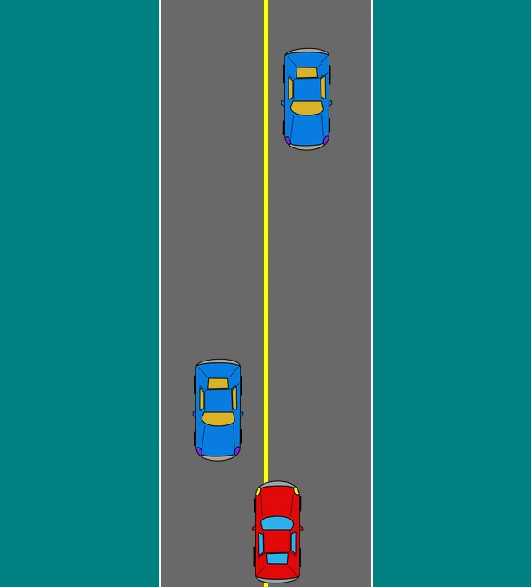
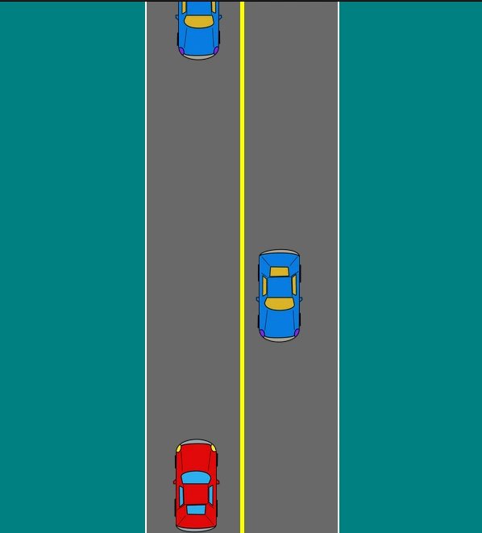

# Car Survival Game

Car Survival Game is a small Java Swing desktop game where you dodge incoming cars and survive as long as possible.

<p align="center">
  
  
</p>

## Features

- Menu screen with Play and Exit actions
- Two-lane survival gameplay
- Score that increases over time
- Game Over screen with Play Again
- Sprite and background audio support from `src/resources`

## Tech Stack

- Java 21
- Swing (UI)
- Gradle (`application` plugin)

## Controls

- `Up Arrow`: move up
- `Down Arrow`: move down
- `Left Arrow`: move left
- `Right Arrow`: move right

## Project Structure

- `src/Main.java`: launcher entry point
- `src/com/carsurvival`: game source code
- `src/resources/sprites`: car sprites
- `src/resources/music`: audio file

## Run (Current Layout)

Prerequisites:

- Java 21+
- Use the included Gradle Wrapper (`gradlew`)

Build classes/resources with Gradle Wrapper:

```bash
./gradlew clean classes
```

Run the game:

```bash
java -cp build/classes/java/main:build/resources/main Main
```

## Build (Gradle)

```bash
./gradlew clean build
```

## Compile/Run Without Gradle

Linux/macOS:

```bash
mkdir -p out
javac --release 21 -d out $(find src -name "*.java")
java -cp out:src/resources Main
```

Windows (PowerShell):

```powershell
New-Item -ItemType Directory -Force out | Out-Null
javac --release 21 -d out (Get-ChildItem -Recurse src -Filter *.java | ForEach-Object { $_.FullName })
java -cp "out;src/resources" Main
```

## IntelliJ IDEA Setup

1. Open the project root as a Gradle project.
2. Set Project SDK to JDK 21 (`File > Project Structure > Project`).
3. Ensure language level is 21.
4. Create an Application run configuration:
   - Main class: `Main`
   - Use classpath of module: project main module
   - Working directory: project root
